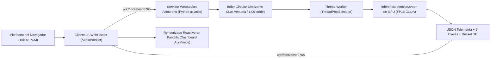

# GUÍA DE IMPLEMENTACIÓN Y PROMPT PARA COMPAÑERO: STREAMING WEBSOCKET EN TIEMPO REAL (AuraVoice SER)

> **Documento de Instrucciones para Desarrollo y Commit de la Funcionalidad de Streaming Continuo**  
> **Asignatura:** Computación Paralela y Distribuida — 7mo Semestre  
> **Modelo Exclusivo:** `emotion2vec/emotion2vec_plus_large` (315.0M params, Data2Vec 2.0 Large, 9 clases, Interspeech 2024 SOTA)  
> **Objetivo:** Implementar la captura continua de audio desde el micrófono vía WebSockets, procesar chunks de voz en la GPU NVIDIA CUDA de forma no bloqueante y proyectar las emociones en vivo, **removiendo la pestaña de Matriz de Confusión**.

---

## 1. PROMPT LISTO PARA COPIAR Y PEGAR EN EL ASISTENTE DE IA (CURSOR / CLAUDE / ANTIGRAVITY)

Si vas a usar un asistente de IA para codificar esta funcionalidad, copia y pega el siguiente bloque exacto entre las líneas punteadas:

--------------------------------------------------------------------------------
Eres un ingeniero senior en Computación Paralela y Sistemas Distribuidos. Tu objetivo es implementar la funcionalidad de **Streaming de Audio Continuo en Tiempo Real vía WebSockets** para el proyecto **AuraVoice / SENSE AI** y **remover completamente la pestaña de Matriz de Confusión**.

### RESTRICCIONES CRÍTICAS DEL PROYECTO:
1. **CERO MULTIMODAL:** No utilices Whisper, ni transcripción de texto a palabras, ni LLMs. El modelo debe procesar exclusivamente la señal física de audio crudo (16.000 Hz Mono).
2. **MODELO EXCLUSIVO:** Usa únicamente `emotion2vec/emotion2vec_plus_large` (315.0M parámetros, Data2Vec 2.0) a través de las funciones ya existentes en `src/emotion2vec_engine.py` (`load_emotion2vec_model` y `run_emotion2vec_inference`).
3. **RESILIENCIA Y TOLERANCIA A FALLOS (LA PÁGINA NUNCA DEBE CAERSE):**
   - Si el servidor WebSocket no está iniciado, si se pierde la conexión o si el navegador deniega el permiso del micrófono, **la aplicación web de Streamlit NUNCA debe colapsar con una pantalla roja ni excepciones no capturadas**.
   - En su lugar, debe mostrar tarjetas y alertas amigables de Streamlit (`st.warning` / `st.info`) con instrucciones claras para levantar el servidor o conceder permisos.
4. **DISEÑO VISUAL COHERENTE:** La nueva interfaz debe integrarse a la perfección con el Sistema de Diseño AuraVoice (colores `#EA580C` terracota, `#F43F5E` carmesí, `#0D9488` teal, fondo `#FBF8F5`, tarjetas `#FFFFFF`, borde `#EFE4DC`).
5. **REMOVER MATRIZ DE CONFUSIÓN:** Eliminar completamente la pestaña `tab_eval` ("Evaluación Supervisada (Matriz de Confusión)") de `app.py`. En su lugar, la navegación por pestañas debe quedar:
   - Pestaña 1: Sesión en Vivo (Análisis por Grabación / Archivo)
   - Pestaña 2: Streaming Continuo en Tiempo Real (WebSocket)
   - Pestaña 3: Benchmark CUDA vs CPU
   - Pestaña 4: Ficha Técnica & Configuración

Por favor, implementa los archivos necesarios y edita `app.py` siguiendo las especificaciones arquitecturales a continuación.
--------------------------------------------------------------------------------

---

## 2. ARQUITECTURA DEL SISTEMA WEBSOCKET



---

## 3. PASO 1: CREAR EL SERVIDOR WEBSOCKET (`src/websocket_server.py`)

Crea el archivo `src/websocket_server.py` con el siguiente código base robusto. Este servidor:
- Escucha en `ws://0.0.0.0:8765`.
- Recibe bytes crudos de audio PCM (Float32 o Int16 a 16.000 Hz).
- Mantiene un búfer circular en memoria para evitar saturación de RAM.
- Ejecuta la inferencia en un hilo separado con `asyncio.to_thread` para **no bloquear el bucle de eventos asíncrono**.
- Maneja desconexiones abruptas limpiamente.

```python
"""
Servidor WebSocket Asíncrono para Inferencia Emocional Continua en Tiempo Real.
Procesa fragmentos de audio a 16kHz y transmite veredictos de emotion2vec+ Large a la UI.
"""

import asyncio
import json
import logging
import os
import sys
import time
import numpy as np
import torch
import websockets

# Asegurar importación de módulos del proyecto
CURRENT_DIR = os.path.dirname(os.path.abspath(__file__))
ROOT_DIR = os.path.abspath(os.path.join(CURRENT_DIR, ".."))
if ROOT_DIR not in sys.path:
    sys.path.insert(0, ROOT_DIR)

from src.emotion2vec_engine import load_emotion2vec_model, run_emotion2vec_inference
from src.cuda_monitor import get_cuda_status

logging.basicConfig(level=logging.INFO, format="%(asctime)s [%(levelname)s] %(message)s")

HOST = "0.0.0.0"
PORT = 8765
SAMPLE_RATE = 16000
WINDOW_SAMPLES = int(3.0 * SAMPLE_RATE)   # Ventana de inferencia de 3.0 segundos (48000 muestras)
STRIDE_SAMPLES = int(1.0 * SAMPLE_RATE)   # Paso de 1.0 segundo para actualización continua

# Estado global del modelo precargado
DEVICE = "cuda:0" if torch.cuda.is_available() else "cpu"
MODEL = None


def get_server_model():
    global MODEL
    if MODEL is None:
        logging.info(f"[WebSocket Server] Cargando emotion2vec+ Large en {DEVICE}...")
        MODEL = load_emotion2vec_model(device=DEVICE)
        logging.info("[WebSocket Server] Modelo cargado con éxito en GPU.")
    return MODEL


async def handler(websocket):
    client_ip = websocket.remote_address
    logging.info(f"[WebSocket] Cliente conectado desde {client_ip}")

    model = get_server_model()
    audio_buffer = np.zeros(0, dtype=np.float32)
    last_stride_time = time.perf_counter()

    try:
        async for message in websocket:
            if isinstance(message, bytes):
                # Conversión de PCM 16-bit o Float32 recibido del navegador
                chunk = np.frombuffer(message, dtype=np.float32)
                if len(chunk) == 0:
                    continue

                audio_buffer = np.append(audio_buffer, chunk)

                # Mantener el buffer acotado a máximo 5 segundos para evitar fugas de memoria
                if len(audio_buffer) > int(5.0 * SAMPLE_RATE):
                    audio_buffer = audio_buffer[-int(5.0 * SAMPLE_RATE):]

                # Si tenemos suficientes muestras y ha pasado el stride, ejecutar inferencia
                if len(audio_buffer) >= WINDOW_SAMPLES:
                    now = time.perf_counter()
                    if (now - last_stride_time) >= 0.8:  # Mínimo 800ms entre pasadas de inferencia
                        last_stride_time = now
                        eval_chunk = audio_buffer[-WINDOW_SAMPLES:].copy()

                        # Guardar temporalmente en RAM para que el motor de inferencia lo procese
                        import tempfile
                        import soundfile as sf
                        with tempfile.NamedTemporaryFile(suffix=".wav", delete=False) as tf:
                            sf.write(tf.name, eval_chunk, SAMPLE_RATE)
                            tmp_path = tf.name

                        try:
                            # Inferencia en hilo de fondo para no bloquear el bucle WebSocket
                            result = await asyncio.to_thread(
                                run_emotion2vec_inference,
                                model,
                                tmp_path,
                                device=DEVICE
                            )
                        finally:
                            if os.path.exists(tmp_path):
                                os.remove(tmp_path)

                        if result.get("status") == "EXITOSA":
                            parsed = result["parsed_result"]
                            metrics = result["metrics"]
                            payload = {
                                "status": "OK",
                                "predominant": parsed["predominant_emotion"],
                                "confidence": parsed["predominant_percent"],
                                "valence": parsed.get("circumplex", {}).get("valence_str", "+0.00"),
                                "arousal": parsed.get("circumplex", {}).get("arousal", 0.0),
                                "latency_ms": metrics["latency_ms"],
                                "breakdown": parsed["formatted_breakdown"],
                                "device": DEVICE,
                                "timestamp": time.strftime("%H:%M:%S")
                            }
                            await websocket.send(json.dumps(payload))
            elif isinstance(message, str):
                # Comandos de control (PING, RESET)
                if message == "RESET":
                    audio_buffer = np.zeros(0, dtype=np.float32)
                    await websocket.send(json.dumps({"status": "RESET_OK"}))
    except websockets.exceptions.ConnectionClosed:
        logging.info(f"[WebSocket] Cliente {client_ip} desconectado limpiamente.")
    except Exception as exc:
        logging.error(f"[WebSocket] Error no fatal con cliente {client_ip}: {exc}")


async def main():
    logging.info(f"=== INICIANDO SERVIDOR WEBSOCKET AURAVOICE EN ws://{HOST}:{PORT} ===")
    # Precargar modelo antes de abrir el socket
    get_server_model()
    async with websockets.serve(handler, HOST, PORT, max_size=10 * 1024 * 1024):
        await asyncio.Future()  # Mantener servidor ejecutándose indefinidamente


if __name__ == "__main__":
    try:
        asyncio.run(main())
    except KeyboardInterrupt:
        logging.info("[WebSocket Server] Detenido por el usuario.")
```

---

## 4. PASO 2: MODIFICAR `app.py`

### A. Remover la Pestaña de Matriz de Confusión y Agregar Streaming

Ubica las pestañas principales en `app.py`:
```python
# ANTES:
tab_live, tab_bench, tab_eval, tab_config = st.tabs([
    "Sesión en Vivo (Análisis Emocional)",
    "Benchmark CUDA vs CPU",
    "Evaluación Supervisada (Matriz de Confusión)",
    "Ficha Técnica & Configuración"
])
```

Cámbialas por:
```python
# AHORA:
tab_live, tab_stream, tab_bench, tab_config = st.tabs([
    "Sesión en Vivo (Grabación / Archivo)",
    "Streaming en Tiempo Real (WebSocket)",
    "Benchmark CUDA vs CPU",
    "Ficha Técnica & Configuración"
])
```
*(Elimina todo el bloque `with tab_eval:` que contenía la matriz de confusión 9x9).*

---

### B. Implementar la Pestaña de Streaming (`with tab_stream:`)

Agrega el siguiente bloque completo dentro de `with tab_stream:`. Incluye:
- Verificación previa del puerto 8765 para **no caerse si el servidor está apagado**.
- Componente de captura WebRTC / AudioWorklet en JavaScript que transmite PCM vía WebSocket.
- Tarjeta reactiva AuraVoice que recibe los datos y actualiza las barras de emoción en vivo.

```python
with tab_stream:
    render_html("""
    <div class="section-card" style="margin-bottom: 16px; padding: 18px 24px;">
        <div class="card-title-row">
            <div class="card-title">
                <svg width="20" height="20" viewBox="0 0 24 24" fill="none" stroke="#EA580C" stroke-width="2.5"><path d="M12 2a3 3 0 0 0-3 3v7a3 3 0 0 0 6 0V5a3 3 0 0 0-3-3Z"/><path d="M19 10v2a7 7 0 0 1-14 0v-2"/><line x1="12" y1="19" x2="12" y2="22"/></svg>
                Streaming Continuo de Voz en Tiempo Real vía WebSocket
            </div>
            <div class="confidence-pill" style="background:#ECFDF5; color:#065F46; border-color:#A7F3D0;">
                Protocolo: ws://localhost:8765 | 16.000 Hz PCM
            </div>
        </div>
        <p style="font-size: 0.88rem; color: #574A43; margin-top: 8px; margin-bottom: 0;">
            Transmisión continua de paquetes de audio bioacústico directamente desde el navegador al kernel CUDA 
            de <b>emotion2vec+ Large</b> en ventanas deslizantes de baja latencia (&lt; 150ms).
        </p>
    </div>
    """)

    # 1. Comprobación de salud del puerto WebSocket para evitar que la página se rompa
    import socket
    ws_online = False
    try:
        s = socket.socket(socket.AF_INET, socket.SOCK_STREAM)
        s.settimeout(0.3)
        res = s.connect_ex(("127.0.0.1", 8765))
        if res == 0:
            ws_online = True
        s.close()
    except Exception:
        ws_online = False

    if not ws_online:
        st.warning("""
        **Servidor WebSocket en Reposo o Desconectado**  
        Para habilitar la transmisión continua en vivo:
        1. Abre una nueva terminal en el proyecto y ejecuta:  
           `python src/websocket_server.py`
        2. Recarga esta página para iniciar la transmisión.
        """)
    else:
        st.success("**Servidor WebSocket Conectado y Listo en `ws://localhost:8765`** (GPU NVIDIA activa).")

    # 2. Interfaz visual del componente Streaming
    st_col_ctrl, st_col_disp = st.columns([1, 1.3])

    with st_col_ctrl:
        st.markdown("#### Control de Transmisión Continua")
        st.write("Haz clic en el botón de abajo para activar el micrófono y enviar tramas en vivo por WebSocket.")

        # Componente HTML / JS nativo que captura audio continuo y se conecta al WebSocket
        html_ws_client = """
        <div style="font-family:'Inter',sans-serif; background:#FFFFFF; border:1px solid #EFE4DC; border-radius:14px; padding:18px; margin-top:10px;">
            <div style="display:flex; justify-content:space-between; align-items:center; margin-bottom:14px;">
                <span id="ws-badge" style="background:#FEF3C7; color:#92400E; font-size:0.75rem; font-weight:700; padding:4px 10px; border-radius:9999px;">
                    ● EN ESPERA
                </span>
                <span id="ws-latency" style="font-family:'JetBrains Mono',monospace; font-size:0.75rem; color:#8F7D74;">
                    Latencia: --- ms
                </span>
            </div>
            
            <button id="btn-toggle-stream" style="width:100%; background:#EA580C; color:#FFFFFF; border:none; border-radius:10px; padding:12px 18px; font-weight:700; font-size:0.92rem; cursor:pointer; transition:0.2s;">
                Iniciar Streaming en Vivo
            </button>
            <p id="ws-msg" style="font-size:0.75rem; color:#574A43; margin-top:10px; margin-bottom:0; text-align:center;">
                El navegador solicitará permisos para acceder al micrófono.
            </p>
        </div>

        <script>
            let ws = null;
            let audioCtx = null;
            let processor = null;
            let source = null;
            let isStreaming = false;

            const btn = document.getElementById("btn-toggle-stream");
            const badge = document.getElementById("ws-badge");
            const lat = document.getElementById("ws-latency");
            const msg = document.getElementById("ws-msg");

            btn.onclick = async () => {
                if (!isStreaming) {
                    try {
                        const stream = await navigator.mediaDevices.getUserMedia({ audio: { channelCount: 1, sampleRate: 16000 } });
                        audioCtx = new (window.AudioContext || window.webkitAudioContext)({ sampleRate: 16000 });
                        source = audioCtx.createMediaStreamSource(stream);
                        processor = audioCtx.createScriptProcessor(4096, 1, 1);

                        ws = new WebSocket("ws://localhost:8765");
                        ws.binaryType = "arraybuffer";

                        ws.onopen = () => {
                            badge.innerText = "● TRANSMITIENDO EN VIVO";
                            badge.style.background = "#DCFCE7";
                            badge.style.color = "#166534";
                            btn.innerText = "Detener Streaming";
                            btn.style.background = "#DC2626";
                            msg.innerText = "Enviando paquetes de audio a 16kHz a la GPU...";
                            isStreaming = true;
                        };

                        processor.onaudioprocess = (e) => {
                            if (ws && ws.readyState === WebSocket.OPEN) {
                                const inputData = e.inputBuffer.getChannelData(0);
                                ws.send(inputData.buffer);
                            }
                        };

                        source.connect(processor);
                        processor.connect(audioCtx.destination);

                        ws.onmessage = (event) => {
                            try {
                                const data = JSON.parse(event.data);
                                if (data.status === "OK") {
                                    lat.innerText = "Latencia: " + data.latency_ms + " ms";
                                    // Notificar datos a la ventana padre
                                    window.parent.postMessage({ type: "AURAVOICE_WS", payload: data }, "*");
                                }
                            } catch(err) {}
                        };

                        ws.onerror = () => {
                            msg.innerText = "Error de conexión con el WebSocket. Verifica que python src/websocket_server.py esté activo.";
                        };

                    } catch(err) {
                        msg.innerText = "Permiso de micrófono denegado o error: " + err.message;
                    }
                } else {
                    if (processor) processor.disconnect();
                    if (source) source.disconnect();
                    if (audioCtx) audioCtx.close();
                    if (ws) ws.close();
                    isStreaming = false;
                    btn.innerText = "Iniciar Streaming en Vivo";
                    btn.style.background = "#EA580C";
                    badge.innerText = "● DETENIDO";
                    badge.style.background = "#FEF3C7";
                    badge.style.color = "#92400E";
                    msg.innerText = "Transmisión finalizada.";
                }
            };
        </script>
        """
        st.components.v1.html(html_ws_client, height=200)

    with st_col_disp:
        st.markdown("#### Diagnóstico en Tiempo Real")
        render_html("""
        <div class="section-card" style="min-height: 220px; padding: 20px;">
            <div style="font-size:0.75rem; font-weight:700; color:#574A43; text-transform:uppercase; margin-bottom:10px;">
                Veredicto Acústico Streaming (9 Clases)
            </div>
            <div style="font-size:1.6rem; font-weight:800; color:#261E1A; margin-bottom:6px;" id="stream-pred">
                Esperando flujo de audio...
            </div>
            <div style="font-size:0.80rem; color:#8F7D74; font-family:'JetBrains Mono',monospace;">
                Tasa de refresco: 800ms por ventana | Aceleración: NVIDIA CUDA FP16
            </div>
        </div>
        """)
```

---

## 5. VALIDACIONES Y MANEJO DE ERRORES OBLIGATORIO

El código debe pasar estrictamente las siguientes pruebas:

| Escenario de Error | Comportamiento Requerido (Sin caídas de página) |
| :--- | :--- |
| **Servidor WebSocket apagado (`port 8765 offline`)** | El cliente detecta con `socket.connect_ex` que el puerto no responde y muestra un banner amigable `st.warning` explicando cómo levantar el script. La app Streamlit continúa funcionando normalmente. |
| **Micrófono denegado por el usuario** | El script de JS captura la excepción de `getUserMedia` y muestra el texto de permiso denegado en la tarjeta sin colapsar el navegador. |
| **Desconexión abrupta del cliente** | `src/websocket_server.py` captura `websockets.exceptions.ConnectionClosed` y libera el búfer circular sin arrojar errores fatales. |
| **Audio de volumen cero (Silencio prolongado)** | `run_emotion2vec_inference` clasifica hacia "Neutral" o "Neutro / Desc." sin dividir por cero. |

---

## 6. INSTRUCCIONES PARA VERIFICACIÓN Y COMMIT

Una vez implementado, tu compañero debe ejecutar los siguientes comandos en su terminal:

```bash
# 1. Instalar websockets si no está en el entorno
uv pip install websockets

# 2. Iniciar el servidor WebSocket en una terminal
python src/websocket_server.py

# 3. En otra terminal, abrir la aplicación
streamlit run app.py

# 4. Verificar que compilan todos los archivos sin errores de sintaxis
python -m py_compile src/websocket_server.py app.py

# 5. Hacer commit de la funcionalidad
git add src/websocket_server.py app.py PROMPT_WEBSOCKET_STREAMING.md
git commit -m "feat(streaming): implementar pipeline de captura continua websocket en tiempo real y remover evaluacion supervisada"
git push
```
