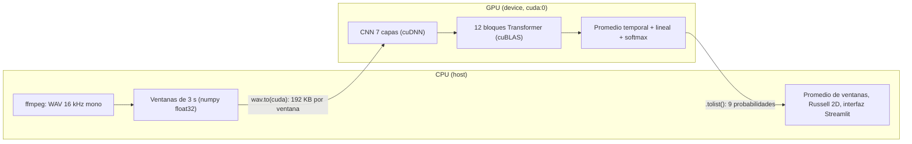

# SENSE AI / AuraVoice — Analizador Emocional de Voz en Tiempo Real

<div align="center">

[](https://www.python.org/)
[](https://pytorch.org/)
[](https://developer.nvidia.com/cuda-toolkit)
[](https://huggingface.co/emotion2vec/emotion2vec_plus_large)
[](https://streamlit.io/)
[](LICENSE.txt)

**Prototipo de Reconocimiento de Emociones en el Habla (SER) con Aceleración en Paralelo sobre Silicio NVIDIA CUDA**  
*Asignatura: Computación Paralela y Distribuida — 7mo Semestre (2026)*

</div>

---

## Tabla de Contenidos
- [SENSE AI / AuraVoice — Analizador Emocional de Voz en Tiempo Real](#sense-ai--auravoice--analizador-emocional-de-voz-en-tiempo-real)
  - [Tabla de Contenidos](#tabla-de-contenidos)
  - [1. Modelo Fundacional Hugging Face: emotion2vec+ Large](#1-modelo-fundacional-hugging-face-emotion2vec-large)
    - [¿Por Qué se Eligió Este Modelo?](#por-qué-se-eligió-este-modelo)
    - [Ajustes Realizados](#ajustes-realizados)
    - [Atención Cuadrática y Ventaneo](#atención-cuadrática-y-ventaneo)
  - [2. Descripcion de la Aplicacion y Problema que Resuelve](#2-descripcion-de-la-aplicacion-y-problema-que-resuelve)
    - [¿Que Problema Resuelve?](#que-problema-resuelve)
    - [¿Que Hace AuraVoice Engine?](#que-hace-auravoice-engine)
  - [3. Pruebas y Funcionamiento en Vivo](#3-pruebas-y-funcionamiento-en-vivo)
    - [Resultados con los Audios de `samples/`](#resultados-con-los-audios-de-samples)
    - [Caso Límite: Dónde se Equivoca el Modelo](#caso-límite-dónde-se-equivoca-el-modelo)
  - [4. Aceleración y Funcionamiento de NVIDIA CUDA](#4-aceleración-y-funcionamiento-de-nvidia-cuda)
    - [Comparación CPU vs GPU (misma entrada, FP32)](#comparación-cpu-vs-gpu-misma-entrada-fp32)
  - [5. Arquitectura del Sistema](#5-arquitectura-del-sistema)
  - [6. Instalacion y Puesta en Marcha](#6-instalacion-y-puesta-en-marcha)
    - [Prerrequisitos](#prerrequisitos)
    - [Paso a Paso con `uv`](#paso-a-paso-con-uv)
    - [Streaming Continuo en Tiempo Real (WebSocket)](#streaming-continuo-en-tiempo-real-websocket)
  - [7. Contribuidores y Licencia](#7-contribuidores-y-licencia)
    - [Integrantes del Grupo](#integrantes-del-grupo)
    - [Licencias](#licencias)

---

## 1. Modelo Fundacional Hugging Face: emotion2vec+ Large

| Dato | Valor |
| :--- | :--- |
| **Identificador** | [`emotion2vec/emotion2vec_plus_large`](https://huggingface.co/emotion2vec/emotion2vec_plus_large) |
| **Publicado por (*issued by*)** | Organización **emotion2vec** en Hugging Face — Ziyang Ma, Zhisheng Zheng, Jiaxin Ye, Jinchao Li, Zhifu Gao, Shiliang Zhang, Xie Chen (SJTU + Alibaba / FunASR) |
| **Artículo** | *emotion2vec: Self-Supervised Pre-Training for Speech Emotion Representation*, [arXiv:2312.15185](https://arxiv.org/abs/2312.15185) |
| **Arquitectura** | Data2Vec 2.0: CNN de 7 capas sobre la forma de onda → 12 bloques Transformer (4 prenet + 8), dimensión 1024, 16 cabezas → promedio temporal → lineal 1024→9 → softmax |
| **Parámetros** | **~300M** según la model card · **162.140.185** contados en el checkpoint con `sum(p.numel())` (la app los mide al cargar) |
| **Precisión en la app** | FP32 (los pesos ocupan ~626 MiB en VRAM) |
| **Entrada / salida** | Audio 16 kHz mono → probabilidades de 9 clases |
| **Datos de ajuste** | ~42.526 h de habla emocional pseudo-etiquetada (40k de 160k h) |
| **Licencia de los pesos** | `model-license` (licencia de modelos de FunASR): uso libre citando la fuente y conservando el nombre del modelo — ver [MODEL_LICENSE.txt](MODEL_LICENSE.txt) |

### ¿Por Qué se Eligió Este Modelo?
1. **Escucha la voz, no las palabras:** no transcribe (sin ASR ni LLM). Clasifica a partir de la señal acústica, por lo que no depende del idioma ni del contenido.
2. **Más datos y más clases:** se ajustó con decenas de miles de horas de habla emocional; muchos modelos SER de Hugging Face (wav2vec2/HuBERT) se entrenaron en un solo corpus actuado en inglés y con 4–8 clases.
3. **Cabe en una GPU de portátil:** ~626 MiB de pesos en FP32, sin necesidad de cuantizar.

### Ajustes Realizados
* **Sin fine-tuning:** no contamos con un dataset etiquetado propio y el modelo ya fue ajustado con ~40k h; entrenar 162M parámetros (gradientes + optimizador) no cabe en 4 GB.
* **Sin cuantización:** el modelo cabe en FP32. FP16/int8 quedan como trabajo futuro.
* **Parámetros de inferencia:** remuestreo a 16 kHz mono, ventanas de 3 s con paso de 2 s (configurable) promediando las probabilidades, `granularity="utterance"`, `torch.inference_mode()`, umbral de silencio RMS < 0.004 en streaming, y carga única con `@st.cache_resource`.

### Atención Cuadrática y Ventaneo
* La atención compara cada frame (50 por segundo) con todos los demás: una matriz T×T por cabeza y por capa. Con 60 s de audio, T = 3.000 y solo los puntajes de una capa ocupan ~576 MB en FP32; en 4 GB eso termina en `CUDA out of memory`.
* Con ventanas de duración fija, la memoria por ventana **no depende de la duración total del audio** (más audio = más ventanas, no ventanas más grandes). Pico medido: ~720–830 MiB en una RTX 3050 Laptop.
* Costo: el modelo no ve contexto más allá de la ventana y el promedio suaviza picos emocionales cortos.
* **Carga offline:** si los pesos ya están en `~/.cache/huggingface/hub/`, se cargan sin red.

---

## 2. Descripcion de la Aplicacion y Problema que Resuelve

### ¿Que Problema Resuelve?
La clasificacion tradicional de afecto y prosodia depende frecuentemente de llamadas a servicios en la nube (APIs propietarias), generando latencias inaceptables (> 1.5s), altos costos por invocacion y graves vulnerabilidades de privacidad al transmitir senales biometricas de voz a centros de datos ajenos.

### ¿Que Hace AuraVoice Engine?
* **Ingesta Acustica Flexible:** Soporta archivos de audio (`.wav`, `.mp3`, `.ogg`, `.m4a`, `.flac`) y grabacion en vivo desde el microfono local con normalizacion a 16.000 Hz Mono.
* **Medidas de la Senal:** nivel RMS y pico en dBFS, F0 mediano y porcentaje de tramas con voz (pYIN). Son descriptivas: el modelo recibe la forma de onda cruda.
* **Espacio Circunflejo de Russell 2D:** Mapeo matematico continuo sobre los ejes de **Valencia** (placer/displacer) y **Activacion / Arousal** (calma/agitacion).
* **Consola Dual AuraTerminal:** telemetria medida (VRAM asignada y pico, tiempo del modelo vs trabajo en CPU, bytes copiados CPU↔GPU, nvidia-smi) y trazabilidad de la decision (medidas de la senal, margen softmax, consistencia entre ventanas, Russell 2D).

---

## 3. Pruebas y Funcionamiento en Vivo

### Resultados con los Audios de `samples/`
Medido el 10-nov-2026 con `run_emotion2vec_inference` (RTX 3050 Laptop, FP32). Los porcentajes son las probabilidades promedio de las ventanas.

| Archivo | Emoción actuada | Predicción (top 3) | Resultado |
| :--- | :---: | :--- | :---: |
| `sample_es.wav` (2,4 s) | — | Tristeza 95,1 · Neutral 4,4 · Miedo 0,2 | — |
| `neutral-en.m4a` | Neutral | Neutral 72,5 · Tristeza 26,1 · Desconocido 1,1 | ✅ |
| `sample_zh.wav` | — | Neutral 97,4 · Disgusto 2,5 | — |
| `alegria-entusiasmo.m4a` | Alegría | Tristeza 36,6 · Neutral 26,3 · Disgusto 22,2 | ❌ |
| `happy-en.m4a` | Alegría | Tristeza 48,2 · Neutral 25,5 · Alegría 25,3 | ❌ |
| `frustración-enojo.m4a` | Enojo | Tristeza 45,0 · Disgusto 19,9 · Neutral 14,0 | ❌ |
| `neutro-calma.m4a` | Neutral | Tristeza 77,1 · Neutral 20,3 · Miedo 1,4 | ❌ |

### Caso Límite: Dónde se Equivoca el Modelo
* **Sesgo hacia "Tristeza":** voces actuadas por no actores, grabadas con micrófono de portátil o celular, con poca energía y entonación plana, se clasifican como tristeza. Neutral y tristeza están cerca en el eje de activación.
* **La confianza baja avisa:** en los fallos la clase ganadora queda entre 36 % y 48 %, frente a > 95 % en los casos claros. La consola XAI marca "predicción incierta" cuando el máximo es < 50 % y muestra qué fracción de ventanas coincide con la decisión.
* **El promedio de ventanas diluye picos** emocionales cortos.
* **Conclusión:** la salida es una estimación estadística de la voz; por eso la app muestra la distribución completa y la línea de tiempo, y no debe usarse como diagnóstico.

---

## 4. Aceleración y Funcionamiento de NVIDIA CUDA



| Parte | Dónde corre |
| :--- | :--- |
| Decodificación (ffmpeg), ventaneo, servidor WebSocket (asyncio), interfaz, post-proceso | **CPU (host)** |
| Pesos del modelo (~626 MiB, copiados una sola vez al cargar), CNN, atención, capas lineales, softmax | **GPU (device)** |

* **Ida (host → device):** `wav.to(device)` copia la forma de onda float32 de cada ventana (3 s = 48.000 muestras = 192 KB) por PCIe.
* **Vuelta (device → host):** `.tolist()` trae las 9 probabilidades; FunASR también copia los embeddings `[T, 1024]`. Esa copia obliga a la CPU a esperar a la GPU (sincronización implícita).
* **Medición:** la app mide el tiempo del modelo entre llamadas a `torch.cuda.synchronize()`, porque CUDA es asíncrono, y lo separa del trabajo en CPU. La VRAM pico sale de `torch.cuda.max_memory_allocated()`.
* **Paralelismo:** las multiplicaciones de matrices del Transformer se reparten entre los 2048 núcleos CUDA de la RTX 3050 Laptop (16 SM). No escribimos kernels a mano: PyTorch usa cuBLAS y cuDNN.

### Comparación CPU vs GPU (misma entrada, FP32)
RTX 3050 Laptop 4 GB vs Ryzen 5 5600H (6 núcleos / 12 hilos), tras una corrida de calentamiento. Reproducible en la pestaña **Benchmark CUDA vs CPU**.

| Prueba | GPU | CPU | Aceleración |
| :--- | ---: | ---: | ---: |
| Solo el forward, tensor de 3 s (promedio de 5) | 25,4 ms | 379 ms | **14,9×** |
| `sample_es.wav` — forward del modelo (2 pasadas) | 64 ms | 704 ms | **11,0×** |
| `sample_es.wav` — proceso completo | 166 ms | 807 ms | **4,9×** |
| `sample_en.wav` (7,2 s) — proceso completo | 288 ms | 2.521 ms | **8,8×** |

La aceleración total es menor que la del modelo porque ffmpeg, el ventaneo y la E/S siguen en CPU en ambos casos (**ley de Amdahl**). Con audios más largos el modelo pesa más en el total y la aceleración crece.

---

## 5. Arquitectura del Sistema

```text
sense-ai-emotion-es/
|
|-- app.py                      # Interfaz reactiva AuraVoice (Streamlit)
|-- requirements.txt            # Dependencias con indice PyTorch CUDA 12.8
|-- README.md                   # Documentacion tecnica del proyecto y del parcial
|-- MODEL_CARD_NOTES.md         # Ficha tecnica formal de emotion2vec+ Large
|-- LICENSE.txt                 # Licencia MIT del codigo
|-- MODEL_LICENSE.txt           # Licencia de los pesos de emotion2vec+ (FunASR)
|
|-- src/                        # Modulos de logica y computacion paralela
|   |-- cuda_monitor.py         # Telemetria de GPU y VRAM (torch.cuda + nvidia-smi)
|   |-- emotion2vec_engine.py   # Motor de inferencia emotion2vec+ Large (9 clases)
|   |-- system_telemetry.py     # CPU/RAM (psutil) y consolas con datos medidos
|   |-- audio_telemetry.py      # RMS, pico dB, F0 y % de voz (pYIN)
|   |-- audio_processor.py      # Conversion de formatos y normalizacion 16kHz
|   |-- result_parser.py        # Modelo circunflejo de Russell 2D y 9 clases
|   |-- evaluator.py            # Metricas supervisadas (Accuracy, F1, Matriz 9x9) - sin uso en la UI
|   |-- websocket_server.py     # Servidor WebSocket asincrono de streaming continuo (ventana 3 s / paso 1 s)
|   |-- streaming_ui.py         # Pestana de streaming: cliente JS (AudioWorklet + WebSocket) y panel en vivo
|   |-- diarization_engine.py   # Motor de diarizacion acustica
|
|-- scripts/                    # Scripts de soporte y puesta en marcha
|   `-- download_model.py       # Descarga y precarga de pesos para nuevos entornos (WSL)
|
|-- tests/                      # Banco de pruebas de terminal
|   |-- test_cuda.py            # Matmul en GPU con torch.cuda.synchronize y VRAM pico
|   |-- test_inference.py       # Inferencia real: parametros, dtype, latencias y VRAM medidos
|
|-- samples/                    # Audios de prueba en espanol
|   |-- sample_es.wav           # Muestra acustica de referencia
|
`-- .streamlit/
    `-- config.toml             # Configuracion de logging y supresion de observadores
```

---

## 6. Instalacion y Puesta en Marcha

### Prerrequisitos
* Sistema Operativo: Linux (nativo), WSL2 o Windows 10/11.
* GPU NVIDIA con soporte CUDA (probado en RTX 3050 Laptop 4 GB y RTX 5050 Laptop 8 GB; Blackwell necesita CUDA 12.8+). Sin GPU funciona en CPU, más lento.
* Controladores NVIDIA instalados (Driver 535+).
* FFmpeg disponible en el PATH del sistema.

### Paso a Paso con `uv`
```bash
# 1. Clonar el repositorio
git clone https://github.com/TU_USUARIO/sense-ai-emotion-es.git
cd sense-ai-emotion-es

# 2. Crear entorno virtual con Python 3.10
uv venv --python 3.10 .venv

# 3. Activar el entorno
source .venv/bin/activate       # Linux / WSL2 / macOS

# 4. Instalar dependencias con soporte CUDA 12.8
uv pip install -r requirements.txt

# 5. Precargar y verificar los pesos del modelo (Solo la primera vez en un equipo nuevo / WSL)
python scripts/download_model.py

# 6. Ejecutar la aplicacion web
streamlit run app.py
```

La interfaz queda accesible en `http://localhost:8501`.

### Streaming Continuo en Tiempo Real (WebSocket)

La pestana **Streaming en Tiempo Real** analiza la voz del microfono de forma continua. Necesita un
segundo proceso: un servidor WebSocket asincrono que mantiene el modelo cargado en la GPU.

```bash
# Terminal 1: servidor de inferencia (carga emotion2vec+ Large en cuda:0 y escucha en ws://0.0.0.0:8765)
source .venv/bin/activate
python src/websocket_server.py

# Terminal 2: interfaz web
source .venv/bin/activate
streamlit run app.py
```

Flujo del pipeline:

1. **Navegador:** captura el microfono con un `AudioWorklet`, remuestrea a 16 kHz mono y envia tramas PCM Float32 de 250 ms por WebSocket.
2. **Servidor (`src/websocket_server.py`):** acumula el audio en un bufer circular acotado a 5 s. Cada 1.0 s de audio nuevo toma la ventana de los ultimos 3.0 s.
3. **Concurrencia:** la inferencia corre en un hilo aparte (`asyncio.to_thread`), asi el bucle de eventos sigue recibiendo audio mientras la GPU trabaja. Un `asyncio.Lock` serializa el acceso al unico modelo en GPU, y si la GPU esta ocupada se descartan las ventanas atrasadas para analizar siempre la mas reciente.
4. **Respuesta:** JSON con la emocion predominante, las 9 probabilidades, valencia/activacion (Russell 2D), latencia y VRAM. El panel se actualiza sin recargar Streamlit.

Tolerancia a fallos: si el servidor esta apagado, la pestana muestra instrucciones en lugar de un error; si se niega el microfono o se pierde la conexion, el panel lo indica y la app sigue funcionando. Las ventanas en silencio (RMS < 0.004) no se envian al modelo.

> El navegador solo permite usar el microfono en `https://` o en `http://localhost`. Abre la app como `http://localhost:8501`.

---

## 7. Contribuidores y Licencia

### Integrantes del Grupo
* **Integrante 1:** JsLealMJohan -> Sebastian Leal Mendez
* **Integrante 2:** Hades0131Andres -> David Benitez
* **Integrante 3:** jhayderstiven03-collab -> Jhayder Florez 

### Licencias
* **Codigo Fuente:** [MIT License](LICENSE.txt).
* **Pesos del Modelo emotion2vec+ Large:** licencia `model-license` de FunASR ([MODEL_LICENSE.txt](MODEL_LICENSE.txt)). El repositorio no redistribuye los pesos: se descargan de Hugging Face, por lo que la licencia MIT del código es compatible.
