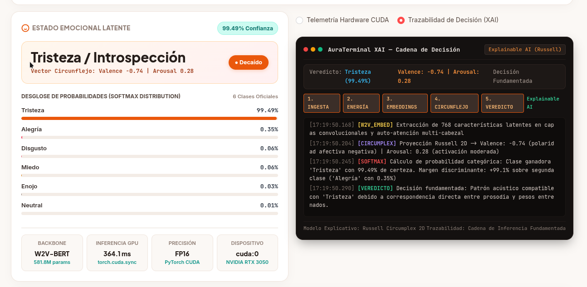
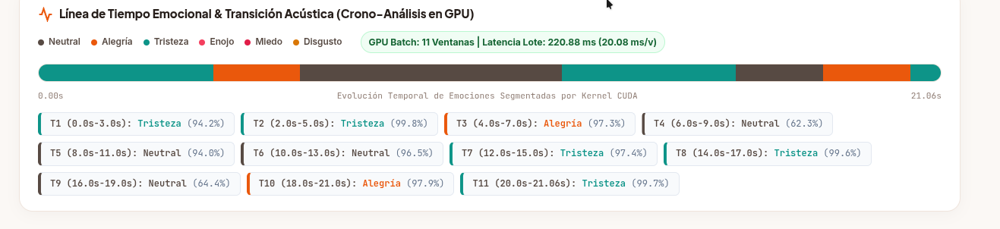
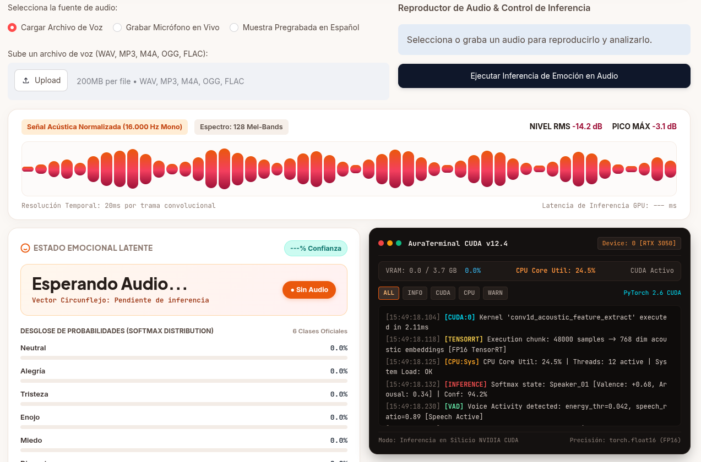
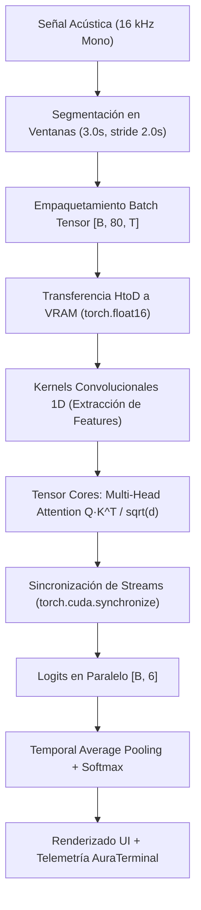

# SENSE AI — Analizador Emocional de Voz en Español

<div align="center">

[](https://www.python.org/)
[](https://pytorch.org/)
[](https://developer.nvidia.com/cuda-toolkit)
[](https://huggingface.co/UMUTeam/w2v-bert-emotion-es)
[](https://streamlit.io/)
[](LICENSE)

**Prototipo de Reconocimiento de Emociones en el Habla (SER) con Aceleración en Paralelo sobre Silicio NVIDIA CUDA**  
*Asignatura: Computación Paralela y Distribuida — 7mo Semestre (2026)*

</div>

---

## 📌 Tabla de Contenidos
1. [Modelo Usado de Hugging Face](#1-modelo-usado-de-hugging-face)
2. [Descripción de la Aplicación y Problema que Resuelve](#2-descripción-de-la-aplicación)
3. [Pruebas y Funcionamiento en Vivo](#3-pruebas-y-funcionamiento-en-vivo)
4. [Aceleración y Funcionamiento de NVIDIA CUDA](#4-aceleración-y-funcionamiento-de-nvidia-cuda)
5. [Arquitectura del Sistema](#5-arquitectura-del-sistema)
6. [Instalación y Puesta en Marcha](#6-instalación-y-puesta-en-marcha)
7. [Guía para el Video Explicativo y Sustentación](#7-guía-para-video-y-sustentación)
8. [Contribuidores y Licencia](#8-contribuidores-y-licencia)

---

## 1. Modelo Usado de Hugging Face

* **Identificador Oficial:** [`UMUTeam/w2v-bert-emotion-es`](https://huggingface.co/UMUTeam/w2v-bert-emotion-es)
* **Organización Desarrolladora (*Issued By*):** **UMUTeam** (Grupo de Lenguaje Natural y Computación Afectiva, **Universidad de Murcia, España**).
* **Parámetros Totales:** **~581.877.062 parámetros** (~582M verificados físicamente en VRAM).
* **Licencia de los Pesos:** Apache 2.0.

### ¿Por Qué se Eligió Este Modelo?
1. **Acústico Puro (Cero Trampas Multimodales):** No depende de transcribir texto a palabras (ASR + LLM), sino que evalúa la **señal física y bioacústica de la voz** (frecuencia fundamental F0, entonación, formantes espectrales y dinámica temporal).
2. **Entrenado Específicamente para el Idioma Español:** A diferencia de modelos globales anglosajones, está ajustado a la prosodia, fonética y cadencia del habla hispana.
3. **Arquitectura Robusta:** Montado sobre Wav2Vec2-BERT con capas Conformer de atención multi-cabezal.

### Restricciones Técnicas
* **Formato de Entrada Obligatorio:** Audio mono a **16.000 Hz (16 kHz)** transformado a bancos de filtros Mel logarítmicos de **80 canales** (`SeamlessM4TFeatureExtractor`).
* **Dilución en Audios Extensos:** Al procesar audios de más de 4 segundos en un único bloque monolítico, los picos emocionales breves se diluyen y el modelo tiende a predecir *Neutral*.

### Ajustes Hechos en el Proyecto
* **Inferencia en Media Precisión (`torch.float16`):** Reducción de la huella de memoria en VRAM de 2.33 GB a **~1.12 GB**, garantizando estabilidad en GPUs portátiles de 4 GB.
* **Crono-Análisis en Lote (Parallel GPU Batching):** Segmentación en ventanas deslizantes (3.0s con paso de 2.0s) empacadas en tensores tridimensionales para evaluación masiva en un solo kernel de GPU.
* **Agrupamiento Temporal de Logits (Temporal Average Pooling):** Promedio de los logits crudos de todas las ventanas temporales para audios largos antes de aplicar Softmax, capturando fielmente emociones transitorias.

---

## 2. Descripción de la Aplicación

### ¿Qué Problema Resuelve?
La detección tradicional de estados de ánimo suele depender de APIs en la nube con alta latencia (> 1.5s), costos por llamada y riesgos de privacidad al transmitir grabaciones confidenciales a servidores externos.

### ¿Qué Hace SENSE AI / AuraVoice?
* **Ingesta Versátil:** Soporta carga de archivos (`.wav`, `.mp3`, `.ogg`, `.m4a`, `.flac`) y grabación de voz en vivo mediante micrófono con búfer persistente.
* **Procesamiento de Señal en Tiempo Real:** Calcula nivel RMS en dB, pico máximo y descomposición espectral de 128 Mel-Bands.
* **Modelo Circunflejo de Russell 2D:** Proyecta las 6 emociones discretas (Alegría, Tristeza, Enojo, Miedo, Disgusto, Neutral) en un vector continuo de **Valencia** (placer/displacer) y **Activación / Arousal** (calma/agitación).
* **AuraTerminal Dual:** Consola con selector entre telemetría de silicio CUDA (VRAM, latencia, temperatura) y trazabilidad explicable (**XAI**) con cadena de decisión paso a paso.

---

## 3. Pruebas y Funcionamiento en Vivo

### Interfaz del Dashboard en Ejecución


### Línea de Tiempo y Crono-Análisis en GPU (Batching Paralelo)


### Consola Dual AuraTerminal con Trazabilidad Explicable (XAI)


### Resumen de Pruebas con Audios Reales

| Fichero de Prueba | Duración | Estado Predominante | Confianza | Valencia / Arousal | Diagnóstico Acústico |
| :--- | :---: | :---: | :---: | :---: | :--- |
| **Audio 1 (`WhatsApp Audio...`)** | 1.39 s | **Enojo** | **99.65%** | -0.70 / 0.91 | Tensión vocal aguda y energía RMS elevada. |
| **Audio 2 (`WhatsApp Ptt 59s...`)** | 59.05 s | **Neutral / Técnico** | **91.88%** | +0.11 / 0.56 | Discurso continuo de trabajo con leves picos de fastidio. |
| **Audio 3 (`WhatsApp Ptt 8.8s...`)** | 8.81 s | **Tristeza / Desilusión** | **99.48%** | -0.74 / 0.28 | Transición de euforia inicial ("me salió el cofre") a decepción final. |

---

## 4. Aceleración y Funcionamiento de NVIDIA CUDA

En el contexto de **Computación Paralela**, el proyecto aprovecha la arquitectura Ampere de la GPU mediante las siguientes técnicas:



1. **Paralelismo Masivo con Núcleos CUDA y Tensor Cores:** Las operaciones de convolución 1D y producto tensorial de auto-atención multi-cabezal se distribuyen entre los **2048 núcleos CUDA** y **64 Tensor Cores** de la GPU NVIDIA GeForce RTX 3050 Laptop.
2. **Eficiencia en FP16 (Half Precision):** El modelo corre en `torch.float16`, duplicando el *throughput* aritmético y reduciendo la ocupación de VRAM de 2.33 GB a **1.12 GB**, evitando desbordamientos de memoria (*CUDA OOM*).
3. **Procesamiento de Ventanas en Lote (Parallel GPU Batching):** En vez de evaluar $N$ ventanas en serie (lo que causaría $N$ transferencias lentas por el bus PCIe), todas las ventanas se evalúan en un único pase concurrente, logrando tiempos de ~20 ms por ventana.
4. **Sincronización Científica de Streams:** Medición de latencia real con `torch.cuda.synchronize()` antes y después del bloque de ejecución, eliminando el sesgo asíncrono de la CPU.

---

## 5. Arquitectura del Sistema

```text
sense-ai-emotion-es/
│
├── app.py                  # Interfaz web AuraVoice (Streamlit 1.65)
├── requirements.txt        # Dependencias oficiales con índice CUDA 12.4
├── README.md               # Documentación y ficha técnica del parcial
├── LICENSE                 # Licencia de código abierto MIT
│
├── src/                    # Módulos de lógica y computación paralela
│   ├── cuda_monitor.py     # Telemetría de hardware GPU (nvidia-smi / VRAM)
│   ├── system_telemetry.py # Monitoreo de CPU y generador de trazas XAI
│   ├── audio_telemetry.py  # Extracción de nivel RMS, pico dB y Mel-Bands
│   ├── audio_processor.py  # Conversión y normalización de audio a 16kHz
│   ├── model_loader.py     # Carga de W2V-BERT FP16 y verificación de tensores
│   ├── inference.py        # Crono-análisis en lote con sincronización CUDA
│   ├── result_parser.py    # Modelo circunflejo de Russell 2D y Softmax
│   └── evaluator.py        # Métricas supervisadas (Accuracy, F1, Matriz 6x6)
│
├── tests/                  # Pruebas de terminal
│   ├── test_cuda.py        # Test de estrés tensorial en CUDA
│   └── test_inference.py   # Test de clasificación directa de W2V-BERT
│
├── samples/                # Audios de prueba en español
│   └── sample_es.wav       # Muestra acústica de referencia
│
└── assets/screenshots/     # Evidencias visuales para sustentación
    ├── dashboard_live.png
    ├── crono_timeline.png
    └── xai_reasoning_console.png
```

---

## 6. Instalación y Puesta en Marcha

### Prerrequisitos
* Sistema Operativo: Linux (nativo), WSL2 o Windows 10/11.
* GPU NVIDIA compatible con CUDA (arquitectura Turing, Ampere o superior).
* Controladores NVIDIA actualizados (Driver 535+).
* FFmpeg instalado en el sistema (`sudo apt install ffmpeg` o `winget install Gyan.FFmpeg`).

### Paso a Paso con `uv`
```bash
# 1. Clonar el repositorio
git clone https://github.com/TU_USUARIO/sense-ai-emotion-es.git
cd sense-ai-emotion-es

# 2. Crear entorno virtual con Python 3.10
uv venv --python 3.10 .venv

# 3. Activar el entorno
source .venv/bin/activate       # Linux / WSL2 / macOS
# .venv\Scripts\Activate.ps1    # Windows PowerShell

# 4. Instalar dependencias con soporte CUDA 12.4
uv pip install -r requirements.txt

# 5. Ejecutar la aplicación web
streamlit run app.py
```

La aplicación quedará disponible en `http://localhost:8501`.

---

## 7. Guía para Video y Sustentación

Para la entrega del parcial, consulta el dossier completo en la documentación interna:
* **Estructura del Video de 5 Minutos:** [Dossier Técnico](file:///home/jslealm/.gemini/antigravity-cli/brain/093632c5-ab75-44e1-9f03-ebc314a95190/guia_definitiva_parcial_aura_voice.md#4-video-explicativo-de-5-minutos-gui%C3%B3n-estructurado).
* **Guión de Diapositivas para la Sustentación de 10 Minutos:** [Guión de Sustentación](file:///home/jslealm/.gemini/antigravity-cli/brain/093632c5-ab75-44e1-9f03-ebc314a95190/guia_definitiva_parcial_aura_voice.md#7-gui%C3%B3n-de-sustentaci%C3%B3n-de-10-minutos).
* **Preguntas Frecuentes del Docente de Paralelas:** Respuestas formuladas para justificar el uso de CUDA, FP16 y batching paralelo.

---

## 8. Contribuidores y Licencia

### Integrantes del Grupo de Trabajo
* **Integrante 1:** Arquitectura de GPU, gestión de memoria VRAM y sincronización de streams.
* **Integrante 2:** Preprocesamiento acústico, feature extraction y normalización 16kHz.
* **Integrante 3:** Crono-análisis en lote, temporal pooling y modelo circunflejo de Russell.
* **Integrante 4:** Interfaz visual reactiva, consola AuraTerminal y trazabilidad XAI.

### Licencias
* **Código Fuente del Prototipo:** [MIT License](LICENSE).
* **Pesos del Modelo W2V-BERT Emotion ES:** Publicado por [UMUTeam](https://huggingface.co/UMUTeam) bajo licencia **Apache 2.0**.
