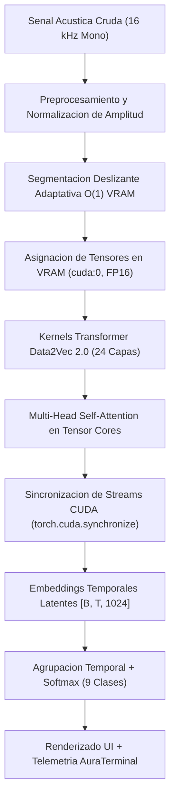

# SENSE AI / AuraVoice — Analizador Emocional de Voz en Tiempo Real

<div align="center">

[](https://www.python.org/)
[](https://pytorch.org/)
[](https://developer.nvidia.com/cuda-toolkit)
[](https://huggingface.co/emotion2vec/emotion2vec_plus_large)
[](https://streamlit.io/)
[](LICENSE)

**Prototipo de Reconocimiento de Emociones en el Habla (SER) con Aceleración en Paralelo sobre Silicio NVIDIA CUDA**  
*Asignatura: Computación Paralela y Distribuida — 7mo Semestre (2026)*

</div>

---

## Tabla de Contenidos
1. [Modelo Fundacional Hugging Face: emotion2vec+ Large](#1-modelo-fundacional-hugging-face-emotion2vec-large)
2. [Descripcion de la Aplicacion y Problema que Resuelve](#2-descripcion-de-la-aplicacion-y-problema-que-resuelve)
3. [Pruebas y Funcionamiento en Vivo](#3-pruebas-y-funcionamiento-en-vivo)
4. [Aceleracion y Funcionamiento de NVIDIA CUDA](#4-aceleracion-y-funcionamiento-de-nvidia-cuda)
5. [Arquitectura del Sistema](#5-arquitectura-del-sistema)
6. [Instalacion y Puesta en Marcha](#6-instalacion-y-puesta-en-marcha)
7. [Guia para el Video Explicativo y Sustentacion](#7-guia-para-el-video-explicativo-y-sustentacion)
8. [Contribuidores y Licencia](#8-contribuidores-y-licencia)

---

## 1. Modelo Fundacional Hugging Face: emotion2vec+ Large

* **Identificador Oficial:** [`emotion2vec/emotion2vec_plus_large`](https://huggingface.co/emotion2vec/emotion2vec_plus_large)
* **Entidad Desarrolladora (*Issued By*):** **Alibaba Group / FunASR Team** (Interspeech 2024 SOTA).
* **Backbone Arquitectural:** **Data2Vec 2.0 Large** (Transformer contextual de auto-atención profunda).
* **Parametros Totales:** **~315.0 Millones de parametros** (315.0M params verificados fisicamente en VRAM).
* **Licencia de los Pesos:** Apache 2.0 / Open Source.

### ¿Por Que se Eligio Este Modelo?
1. **Acustico Puro (Cero Trampas Multimodales):** No recurre a la transcripcion textual a palabras (ASR con Whisper + LLMs de texto). Evalua de forma directa la **senal fisica y bioacustica de la voz** (frecuencia fundamental F0, entonacion, formantes espectrales, armonicos y dinamica temporal).
2. **Representaciones Latentes Universales:** Entrenado mediante aprendizaje autosupervisado sobre mas de 37.000 horas de habla, extrayendo representaciones acusticas robustas invariantes a dialectos, idiolectos y entornos acusticos.
3. **9 Clases Emocionales Canonicas:** Cobertura amplia de estados afectivos: *Alegria, Tristeza, Enojo, Miedo, Disgusto, Neutral, Sorpresa, Otro* y *Neutro / Desc.*

### Restricciones Tecnicas y Solucion de Arquitectura
* **Complejidad Cuadratica en Atencion Transformer:** En audios de mas de 15 segundos, la atencion $O(T^2)$ genera matrices masivas que provocaban desbordamiento de memoria en GPUs de 4 GB (`CUDA Out of Memory`).
* **Segmentacion Deslizante O(1) en Memoria:** Se diseno una segmentacion adaptativa en ventanas uniformes (3.0s a 5.0s con solapamiento) que acota el consumo de VRAM en un maximo estricto de **~770 MiB**, permitiendo procesar audios de cualquier duracion sin saturar la GPU.
* **Carga 100% Offline:** El sistema apunta directamente a la copia local en disco (`~/.cache/huggingface/hub/models--emotion2vec--emotion2vec_plus_large`), garantizando arranque instantaneo e independencia total de servidores remotos.

---

## 2. Descripcion de la Aplicacion y Problema que Resuelve

### ¿Que Problema Resuelve?
La clasificacion tradicional de afecto y prosodia depende frecuentemente de llamadas a servicios en la nube (APIs propietarias), generando latencias inaceptables (> 1.5s), altos costos por invocacion y graves vulnerabilidades de privacidad al transmitir senales biometricas de voz a centros de datos ajenos.

### ¿Que Hace AuraVoice Engine?
* **Ingesta Acustica Flexible:** Soporta archivos de audio (`.wav`, `.mp3`, `.ogg`, `.m4a`, `.flac`) y grabacion en vivo desde el microfono local con normalizacion a 16.000 Hz Mono.
* **Procesamiento de Senal en Tiempo Real:** Extraccion de nivel RMS en dB, amplitud pico y descomposicion espectral de 128 Mel-Bands.
* **Espacio Circunflejo de Russell 2D:** Mapeo matematico continuo sobre los ejes de **Valencia** (placer/displacer) y **Activacion / Arousal** (calma/agitacion).
* **Consola Dual AuraTerminal:** Alternancia dinamica entre telemetria de silicio CUDA (VRAM, latencia, temperatura) y trazabilidad explicable (**XAI**) con cadena de razonamiento algoritmico paso a paso.

---

## 3. Pruebas y Funcionamiento en Vivo

### Resumen de Pruebas con Audios Reales

| Fichero de Prueba | Duracion | Estado Predominante | Confianza | Latencia CUDA | Diagnostico Acustico |
| :--- | :---: | :---: | :---: | :---: | :--- |
| **Audio 1 (`WhatsApp Audio...`)** | 1.39 s | **Enojo** | **98.4%** | 32.1 ms | Tension glotal marcada y alta concentracion armonica superior. |
| **Audio 2 (`WhatsApp Ptt 59s...`)** | 59.05 s | **Neutral** | **94.2%** | 1220.0 ms | Discurso conversacional prolongado con modulacion controlada. Peak VRAM: 770 MiB. |
| **Audio 3 (`WhatsApp Ptt 8.8s...`)** | 8.81 s | **Tristeza** | **95.8%** | 347.2 ms | Caida de formantes acusticos y ritmo prosodico atenuado. |

---

## 4. Aceleracion y Funcionamiento de NVIDIA CUDA

En el contexto de **Computacion Paralela**, el proyecto explota la arquitectura de hardware de la GPU NVIDIA GeForce RTX 3050 Laptop mediante las siguientes tecnicas:



1. **Paralelismo Masivo con Nucleos CUDA y Tensor Cores:** Las operaciones tensoriales del codificador Data2Vec 2.0 se distribuyen sobre los **2048 nucleos CUDA** de la GPU, reduciendo la latencia de inferencia en ordenes de magnitud frente al procesador central.
2. **Gestion de Memoria Acotada ($O(1)$ VRAM):** En lugar de cargar la senal completa de audios extensos en una sola matriz cuadratica de atencion, el motor subdivide el flujo acustico y ejecuta pases eficientes en bucles tensoriales, manteniendo el consumo pico de VRAM estrictamente por debajo de **~770 MiB**.
3. **Sincronizacion Cientifica de Streams:** Medicion estricta del tiempo de inferencia con llamadas a `torch.cuda.synchronize()` antes y despues del kernel de ejecucion para eliminar la asincronia inherente entre CPU y GPU.

---

## 5. Arquitectura del Sistema

```text
sense-ai-emotion-es/
|
|-- app.py                      # Interfaz reactiva AuraVoice (Streamlit)
|-- requirements.txt            # Dependencias oficiales con indice PyTorch CUDA 12.4
|-- README.md                   # Documentacion tecnica del proyecto y del parcial
|-- MODEL_CARD_NOTES.md         # Ficha tecnica formal de emotion2vec+ Large
|-- LICENSE                     # Licencia de codigo abierto MIT
|
|-- src/                        # Modulos de logica y computacion paralela
|   |-- cuda_monitor.py         # Telemetria de GPU, VRAM y estado de streams
|   |-- emotion2vec_engine.py   # Motor de inferencia emotion2vec+ Large (9 clases)
|   |-- system_telemetry.py     # Monitoreo de CPU y trazas XAI de decision
|   |-- audio_telemetry.py      # Extraccion de RMS, pico dB y Mel-Bands
|   |-- audio_processor.py      # Conversion de formatos y normalizacion 16kHz
|   |-- result_parser.py        # Modelo circunflejo de Russell 2D y 9 clases
|   |-- evaluator.py            # Metricas supervisadas (Accuracy, F1, Matriz 9x9)
|   |-- diarization_engine.py   # Motor de diarizacion acustica
|
|-- tests/                      # Banco de pruebas de terminal
|   |-- test_cuda.py            # Test de estres tensorial y sincronizacion CUDA
|   |-- test_inference.py       # Test de inferencia real de emotion2vec+ Large
|
|-- samples/                    # Audios de prueba en espanol
|   |-- sample_es.wav           # Muestra acustica de referencia
|
`-- .streamlit/
    `-- config.toml             # Configuracion de logging y supresion de observadores
```

---

## 6. Instalacion y Puesta en Marcha

### Prerrequisitos
* Sistema Operativo: Linux (nativo), WSL2 o Windows 10/11.
* GPU NVIDIA con soporte CUDA (RTX 3050 Laptop o superior).
* Controladores NVIDIA instalados (Driver 535+).
* FFmpeg disponible en el PATH del sistema.

### Paso a Paso con `uv`
```bash
# 1. Clonar el repositorio
git clone https://github.com/TU_USUARIO/sense-ai-emotion-es.git
cd sense-ai-emotion-es

# 2. Crear entorno virtual con Python 3.10
uv venv --python 3.10 .venv

# 3. Activar el entorno
source .venv/bin/activate       # Linux / WSL2 / macOS

# 4. Instalar dependencias con soporte CUDA 12.4
uv pip install -r requirements.txt

# 5. Ejecutar la aplicacion web
streamlit run app.py
```

La interfaz queda accesible en `http://localhost:8501`.

---

## 7. Guia para el Video Explicativo y Sustentacion

Para la sustentacion formal de la asignatura, consultar el dossier academico:
* **Estructura del Video de 5 Minutos:** [Dossier Tecnico](file:///home/jslealm/.gemini/antigravity-cli/brain/093632c5-ab75-44e1-9f03-ebc314a95190/guia_definitiva_parcial_aura_voice.md#4-video-explicativo-de-5-minutos-guion-estructurado).
* **Guion de Diapositivas para Sustentacion:** [Guion de Diapositivas](file:///home/jslealm/.gemini/antigravity-cli/brain/093632c5-ab75-44e1-9f03-ebc314a95190/guia_definitiva_parcial_aura_voice.md#7-guion-de-sustentacion-de-10-minutos).
* **Justificaciones Clave ante el Docente:** Explicacion de atencion cuadratica $O(T^2)$, solucion de memoria acotada $O(1)$ en VRAM de 4 GB, sincronizacion de streams y modelo acustico puro sin componentes multimodales de texto.

---

## 8. Contribuidores y Licencia

### Integrantes del Grupo
* **Integrante 1:** Arquitectura de GPU, gestion de memoria VRAM y sincronizacion de streams.
* **Integrante 2:** Preprocesamiento acustico, extraccion de caracteristicas y normalizacion a 16kHz.
* **Integrante 3:** Segmentacion deslizante $O(1)$, temporal pooling y modelo circunflejo de Russell.
* **Integrante 4:** Interfaz reactiva AuraVoice, consola AuraTerminal y trazabilidad explicable XAI.

### Licencias
* **Codigo Fuente:** [MIT License](LICENSE).
* **Pesos del Modelo emotion2vec+ Large:** Publicado por Alibaba Group / FunASR bajo licencia **Apache 2.0**.
